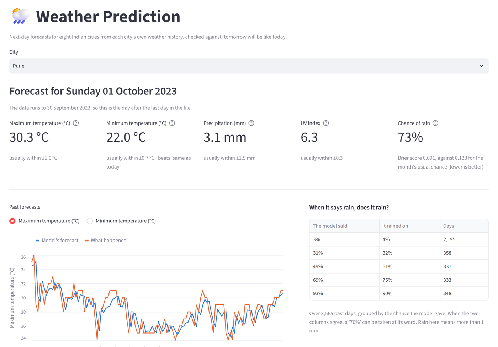

<h1 align="center">Weather Prediction</h1>

<p align="center"><strong>Forecasts tomorrow's temperature, chance of rain and UV index for eight Indian cities from today's weather, and says honestly how good that forecast is.</strong></p>

<p align="center">
  <a href="https://github.com/Cl0ud-9/Weather-Prediction-Model/actions/workflows/ci.yml"></a>
  <a href="LICENSE"></a>
  
  
</p>

<p align="center">
  <a href="#quick-start">Quick start</a> &nbsp;·&nbsp;
  <a href="#how-it-works">How it works</a> &nbsp;·&nbsp;
  <a href="#results">Results</a> &nbsp;·&nbsp;
  <a href="#the-data">The data</a> &nbsp;·&nbsp;
  <a href="#honest-limits">Honest limits</a>
</p>

<br>

<p align="center">
  
</p>

Pick a city and the model predicts the next day's maximum and minimum temperature, rainfall, UV index and **chance of
rain**, using the latest day in the data. Every prediction is checked against the simplest possible forecasts, such as
"tomorrow will be like today", so you can see what the model actually adds.

Cities: Bengaluru, Bombay, Delhi, Hyderabad, Jaipur, Kanpur, Nagpur and Pune.

## Quick start

You need Python 3.11, 3.12, 3.13 or 3.14. The data is in the repository.

```bash
git clone https://github.com/Cl0ud-9/Weather-Prediction-Model.git
cd Weather-Prediction-Model
python -m venv .venv
.venv\Scripts\activate          # macOS/Linux: source .venv/bin/activate
pip install -r requirements.txt
python predict.py pune          # in the terminal
streamlit run app.py            # or the dashboard, at http://localhost:8501
```

```text
Pune: data runs to 30 Sep 2023. Forecast for 01 Oct 2023:
  Maximum temperature (°C)     30.3
  Minimum temperature (°C)     22.0
  Precipitation (mm)            3.1
  UV index                      6.3
  Chance of rain                73%   (more than 1 mm)

Mean absolute error over past days (model vs 'tomorrow will be like today'):
  Maximum temperature (°C)     0.99 vs   0.95   (3565 days)
  Minimum temperature (°C)     0.66 vs   0.75   (3565 days)
  Precipitation (mm)           1.52 vs   1.43   (3565 days)
  UV index                     0.30 vs   0.23   (3565 days)

Chance of rain, Brier score (0 is perfect): 0.091, against 0.121 for 'rain if it rained today' and 0.123 for the usual share of rainy days that month
```

`python predict.py all` prints the accuracy tables below for every city. `--no-backtest` skips the accuracy check.

### The dashboard

`streamlit run app.py` shows the same forecast for any city, each number with how far off it has usually been, a chart
of the model's past forecasts against what happened, and how often it rained when the model gave each chance. It runs
as one process with the data in the repository, so [Streamlit Community Cloud](https://share.streamlit.io) can host it
as it is: **Create app**, pick this repository and `app.py`.

## How it works

```
hourly readings ──> one row per day ──> today's weather + recent history ──> ridge regression ──> tomorrow
                    (daily values once,   (yesterday, 7- and 30-day means,
                     hourly ones averaged, season of the year)
                     rain summed)
```

1. **Daily rows.** The source has one row per hour, but its maximum and minimum temperature and its UV index are
   daily values repeated on all 24 rows. Each day becomes one row: those values once, hourly readings such as
   humidity and pressure averaged, rain added up, and wind direction averaged as an angle.
2. **Tomorrow as the target.** Each day is paired with the next calendar day. If the next day is missing from the
   data, the day is not used, so a gap never turns into a two-day jump.
3. **Features.** Today's readings, each target's value yesterday and its 7- and 30-day averages, and the time of
   year as a point on a circle.
4. **Model.** Ridge regression on standardised features, one model per target. For the chance of rain, logistic
   regression on the same features predicts whether tomorrow brings more than 1 mm.
5. **Backtest.** The model trains on the first two years, predicts the next 90 days, adds them to its training data
   and moves on, so it is only ever tested on days after everything it learned from.

## Results

Mean absolute error of the model against "tomorrow will be like today", over every backtested day (about 3,200 to
3,600 days per city). Lower is better; **bold** marks where the model wins.

| City | Max temp (°C) | Min temp (°C) | Rain (mm) | UV index |
|---|---|---|---|---|
| Bengaluru | **1.10** vs 1.17 | **0.62** vs 0.68 | **1.84** vs 1.92 | 0.37 vs 0.32 |
| Bombay | 0.74 vs 0.69 | 0.65 vs 0.65 | 2.61 vs 2.30 | 0.27 vs 0.19 |
| Delhi | **1.26** vs 1.28 | **0.89** vs 1.11 | 1.07 vs 1.03 | 0.37 vs 0.31 |
| Hyderabad | **1.16** vs 1.17 | **0.71** vs 0.82 | 1.63 vs 1.46 | 0.36 vs 0.30 |
| Jaipur | **1.12** vs 1.16 | **0.85** vs 1.07 | 0.98 vs 0.89 | 0.34 vs 0.27 |
| Kanpur | **1.25** vs 1.28 | **0.85** vs 1.07 | 1.25 vs 1.17 | 0.37 vs 0.30 |
| Nagpur | 1.17 vs 1.16 | **0.75** vs 0.93 | 2.24 vs 1.95 | 0.35 vs 0.29 |
| Pune | 0.99 vs 0.95 | **0.66** vs 0.75 | 1.52 vs 1.43 | 0.30 vs 0.23 |

What this says: the model forecasts the minimum temperature better than persistence in seven cities out of eight, and
the maximum temperature about as well. For the amount of rain and the UV index, the obvious guess wins.

### Chance of rain

Whether it will rain is easier to forecast than how much. The Brier score is the mean squared error of a probability:
0 is perfect, and always saying 50% scores 0.25. The model beats both "rain tomorrow if it rained today" and the usual
share of rainy days in that month, in every city:

| City | Model | Same as today | Usual for the month | Rainy days |
|---|---|---|---|---|
| Bengaluru | **0.140** | 0.213 | 0.185 | 33% |
| Bombay | **0.058** | 0.075 | 0.083 | 30% |
| Delhi | **0.081** | 0.118 | 0.096 | 13% |
| Hyderabad | **0.098** | 0.145 | 0.133 | 20% |
| Jaipur | **0.069** | 0.105 | 0.085 | 12% |
| Kanpur | **0.074** | 0.117 | 0.092 | 14% |
| Nagpur | **0.079** | 0.112 | 0.110 | 22% |
| Pune | **0.091** | 0.121 | 0.123 | 26% |

Its chances can be taken at face value. In Pune, on the days it said about 30% it rained on 32% of them, at about 50%
on 51%, at about 70% on 75%, and at about 90% on 90%.

**Tried and not kept.** A gradient-boosted model on the same features did not beat ridge regression. Giving each city
the other seven cities' weather of the same day (weather moves across India, so this seemed promising) made the
forecasts slightly worse in 30 of the 32 city-and-measure pairs (one was better, Kanpur's maximum temperature, and one
the same): with a few thousand training days, the extra 49 columns cost more in noise than they added.

## The data

[Historical Weather Data for Indian Cities](https://www.kaggle.com/datasets/hiteshsoneji/historical-weather-data-for-indian-cities)
on Kaggle, one CSV per city in [data/](data):

| City | Days used | From – to |
|---|---|---|
| Bengaluru, Bombay, Hyderabad, Jaipur, Kanpur, Nagpur | about 3,980 each | Jan 2012 – Nov 2023 |
| Delhi | 4,017 | Jan 2009 – Dec 2023, with gaps |
| Pune | 4,299 | Jan 2009 – Sep 2023, with gaps |

Cleaning, done when a file is loaded: three empty rows, a full day of rows dated 29 February 2023 (a date that does
not exist) and repeated hours in the Pune and Delhi files are dropped, and days with fewer than 20 hourly readings are
left out. The files themselves are unchanged.

## Honest limits

<details>
<summary>What the forecast can and cannot tell you</summary>

<br>

- **It only knows one place's own past.** Real forecasts use satellites, pressure systems and neighbouring regions.
  This model sees one city's history, which is why "same as yesterday" is so hard to beat.
- **The data stops in 2023.** `predict.py` forecasts the day after the last day in the file, not tomorrow's date.
- **Rain amounts are the hardest.** Most days have none, and the model cannot see a storm coming. Use the chance of
  rain, which is well calibrated, rather than the amount.
- **UV index is a whole number that rarely changes**, so yesterday's value is already an excellent guess.

</details>

## Project structure

```text
app.py                     the dashboard (Streamlit)
predict.py                 forecast a city, or print the accuracy tables for all of them
weather/
  data.py                  reading the hourly files and turning them into days
  model.py                 features, the models, the backtests and the forecast, including the chance of rain
data/                      the eight city files
notebooks/                 the original 2024 notebook (see notebooks/README.md)
tests/                     pytest suite on generated data
```

## Development

```bash
pip install -r requirements-dev.txt
ruff check .
pytest
```

The tests build a small file in the source's format, with its quirks, and check the cleaning, the daily rows, that
targets are the next calendar day, that both backtests only learn from the past, the forecast, the chance of rain and
the command line, and they run the dashboard headless on the real data.
They run on every push for Python 3.11 to 3.14. See [CONTRIBUTING.md](CONTRIBUTING.md) before opening a pull request,
and [SECURITY.md](SECURITY.md) to report a vulnerability. [CHANGELOG.md](CHANGELOG.md) says what changed in each version.

## License

The project is **source-available**: Copyright 2024-2026 Cloud/9, all rights reserved. You can read the source, run it
for personal, educational and non-commercial research use, and fork it to contribute back. Redistributing it,
publishing modified copies, running it as a service for other people, selling it, or using it to train other models is
not allowed without written permission. See [LICENSE](LICENSE) for the full terms.

The weather data and the libraries the project uses keep their own terms, listed in [NOTICE](NOTICE).

<br>

<p align="center">
  <sub>Made by <a href="https://github.com/Cl0ud-9">Cloud/9</a>.</sub>
</p>
